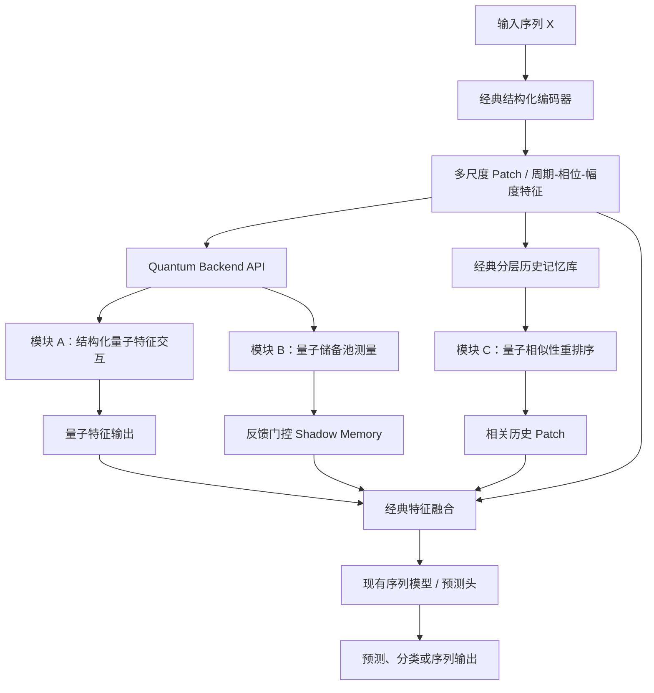

# Quantum-Enhanced Structured Sequence Modeling

**Infleqtion Hackathon · Challenge 2: Give Your LLM a Quantum Backend**  
**项目方案（讨论版 V1.0）**  
**主要应用：时间序列预测（Time Series Forecasting）与序列处理（Sequence Processing）**

## 1. 项目目标与核心思想

本项目面向结构化序列中的**周期性特征交互、长期依赖及任务相关记忆**，构建一个模块化的 **Hybrid Quantum–Classical Sequence Modeling Framework**。在经典序列模型的输入表示、特征融合和预测流程中，接入可独立执行的量子计算后端，探索量子态编码、Data Re-uploading、结构化纠缠、量子测量与量子相似性等机制在特定序列任务中的价值。

### 1.1 核心研究问题

1. **周期结构与特征交互**：相位编码和结构化量子电路能否有效表征周期内（Intra-Period）及周期间（Inter-Period）的幅度、相位、趋势和跨变量交互？
2. **记忆与信息保留**：量子储备池的测量特征能否通过反馈门控和辅助记忆状态，改善长期历史信息的保留及利用？
3. **历史模式检索**：量子特征映射构造的相似性，能否帮助分层记忆库匹配预测相关的历史 Patch？
4. **机制解释与效率**：哪些编码方式、纠缠拓扑、观测量和反馈机制贡献了任务性能？其精度、时间与资源成本如何？

### 1.2 项目成果

- 可运行的**经典序列模型 + 量子后端**端到端应用，完成输入、量子任务执行、结果返回、融合与输出。
- 以 **Structured Quantum Periodic Interaction** 为核心的可训练量子特征模块。
- **Feedback-Gated Quantum Shadow Memory** 辅助记忆原型，并比较任务导向表示和知识蒸馏策略。
- **Quantum-Assisted Hierarchical Retrieval** 的独立实验及可选集成模块。
- Synthetic Tasks、真实 Benchmark、消融与资源测评。
- 可复现 GitHub 仓库、简短技术演示和结果汇报。

---

## 2. 整体系统框架



### 2.1 数据流

给定多变量输入序列

\[
X\in\mathbb R^{L\times C},
\]

其中 \(L\) 为输入窗口长度，\(C\) 为变量数。经典编码器进行多尺度分块、标准化及结构化特征提取：

\[
\mathcal P=\{P_1,\ldots,P_N\},\qquad z_i=E_\theta(P_i).
\]

量子后端接收低维 \(z_i\) 或特征对 \((z_i,z_j)\)，执行量子电路并返回测量期望、联合观测量或相似性分数：

\[
q_i=Q_\phi(z_i),\qquad q_{ij}=Q^{\mathrm{pair}}_\phi(z_i,z_j).
\]

融合层综合经典特征、量子特征、辅助记忆及检索结果：

\[
\tilde h_t=F_\omega(h_t^{\mathrm{classical}},q_t,s_t,r_t),\qquad
\hat Y=G_\psi(\tilde h_{1:T}).
\]

### 2.2 模块边界与接口

| 模块 | 输入 | 处理内容 | 输出 |
|---|---|---|---|
| Classical Encoder | 原始序列、Patch | 分块、降维、周期与相位特征 | 低维表示 \(z\) |
| Quantum Interaction | 单个或多个 Patch 特征 | 编码、重上传、纠缠、测量 | 交互特征 \(q\) |
| Quantum Reservoir | 当前输入、反馈信号 | 量子演化与测量 | 测量特征 \(m_t\) |
| Shadow Memory | \(m_t\)、历史记忆、当前特征 | 门控更新、压缩融合 | 辅助记忆 \(s_t\) |
| Hierarchical Retrieval | 查询与候选历史 Patch | 社区召回、量子重排序 | Top-K 历史记忆 |
| Classical Fusion / Head | 所有返回特征 | 特征融合、序列建模、输出 | \(\hat Y\) |

量子后端按统一接口封装：`encode(features)`、`run_interaction(features)`、`measure_reservoir(features, feedback)`、`score_candidates(query, candidates)`。运行记录包括模拟器或硬件配置、shots、电路深度、qubit 数量和耗时。

---

## 3. 研究方向 A：Structured Quantum Periodic Interaction

### 3.1 模块需求与量子机制

时间序列常同时具有局部波形、跨周期重现、幅相耦合、趋势变化与多变量依赖。模块 A 将这些结构映射到量子线路的输入编码和纠缠连接：

- **Intra-Period**：学习同一 Patch 内不同位置或不同子特征之间的关系。
- **Inter-Period**：学习相邻周期、远距离周期和不同尺度 Patch 之间的关联。
- **Phase–Amplitude Interaction**：联合处理幅度、相位、频率、趋势等信息。
- **Structured Entanglement**：依据周期结构设计相邻、跨周期与跨尺度 Qubit 连接。

### 3.2 特征表示与量子编码

为每个周期 Patch 构造特征（由经典提取器或可训练编码器获得）：

\[
z_i=[A_i,\varphi_i,\omega_i,\tau_i,\ldots].
\]

量子态通过数据依赖的旋转门制备：

\[
|\psi(z_i)\rangle=U_{\mathrm{enc}}(z_i)|0\rangle^{\otimes q}.
\]

可比较的编码机制：

1. **Angle Encoding**：使用 \(R_y(g_j(z))\) 编码数值特征。
2. **Phase Encoding**：在形成叠加态后，用 \(R_z(h_j(z))\) 编码相位信息。
3. **Hybrid Amplitude–Phase Encoding**：联合编码幅度和相位。
4. **Data Re-uploading**：重复执行数据编码与可训练量子门：

\[
U(z,\theta)=V_D(\theta_D)E(z)\cdots V_1(\theta_1)E(z).
\]

合适的数据编码电路可产生有限傅里叶形式的函数表达：

\[
f_\theta(z)=\sum_{\nu\in\Omega}c_\nu(\theta)e^{i\nu\cdot z}.
\]

因此重点研究多变量幅度—相位关系下的可表达交互，而不仅是单变量周期函数拟合。

### 3.3 周期内/周期间纠缠拓扑

设计四类可替换线路：

- `Q0`: 无纠缠（Independent Encoding）。
- `Q1`: 局部相邻纠缠（Local）。
- `Q2`: 跨周期/跨尺度结构化纠缠（Cross-Period / Cross-Scale）。
- `Q3`: 全连接纠缠（All-to-All）。

可使用 CNOT、CZ、\(R_{ZZ}(\gamma)\) 等门。量子特征输出包括单体观测量和联合观测量：

\[
q(z)=\big[\langle X_i\rangle,\langle Z_i\rangle,\langle X_iX_j\rangle,\langle Z_iZ_j\rangle\big].
\]

具体观测基底与门序列联合设计，以确保相位相关交互可以影响最终测量输出。

### 3.4 核心假设

- **H-A1**：联合幅相量子编码在受控的高阶周期交互任务中，具有可测量的表达或泛化收益。
- **H-A2**：与无结构连接相比，依据周期关系设计的量子交互拓扑对某些时序依赖具有更合适的归纳偏置。
- **H-A3**：量子特征在真实时序预测中可作为有用的辅助表示，并具有可量化的推理成本。

---

## 4. 研究方向 B：Feedback-Gated Quantum Shadow Memory

### 4.1 模块目标

建立一个**量子测量特征 → 经典辅助记忆 → 反馈更新 → 预测融合**的循环模块。量子储备池对当前输入与反馈信息进行量子变换，测量后产生任务相关统计量，并由 Shadow Memory 保留和更新。

此处 **Shadow Memory** 指利用量子测量输出建立的辅助经典记忆状态；可进一步评估 *Classical Shadow* 测量协议作为观测量估计工具的适配性。

### 4.2 测量与辅助记忆

量子后端接收当前特征 \(z_t\) 和先前反馈 \(f_{t-1}\)：

\[
\rho_t^-=\mathcal E_{\phi,z_t,f_{t-1}}(\rho_{\mathrm{init}}),
\qquad m_t=\mathcal M(\rho_t^-).
\]

其中 \(\mathcal M\) 返回指定 Pauli 观测量的期望、联合相关统计或压缩测量表示。使用 \(m_t\) 更新辅助记忆：

\[
g_t=\sigma(W_g[z_t;s_{t-1};m_t]+b_g),
\]
\[
\tilde s_t=\tanh(W_s[z_t;s_{t-1};m_t]+b_s),
\]
\[
s_t=(1-g_t)\odot s_{t-1}+g_t\odot\tilde s_t,
\qquad f_t=F_\gamma(s_t,m_t).
\]

最终融合 \(s_t\) 与现有序列模型的隐藏表示。可进一步探索辅助量子寄存器测量与持续量子记忆态的设计。

### 4.3 两种表示策略及比较

**T — Task-Oriented Representation**

- 以预测、分类或检索目标训练量子模块与融合层。
- 学习一组对最终任务有用的测量特征。
- 比较不同观测量集合与记忆维度。

**D — Knowledge Distillation**

- 训练 Quantum Teacher 输出特征或预测。
- 使用匹配的经典 Student 拟合 Teacher 的测量表示或预测分布。
- 记录 Student 相对 Teacher 的精度、推理效率和资源成本。

**T+D — Combined Strategy**

- 先进行任务导向量子表示训练，再蒸馏为经典 Student。
- 将量子路径、Student 路径与混合路由方案进行统一对比。

### 4.4 反馈与记忆消融

- Classical Gated Memory
- Quantum Measurements + Direct Fusion
- Quantum Measurements + Shadow Memory
- Quantum Measurements + Feedback-Gated Shadow Memory
- Quantum Teacher + Distilled Student

核心观察量：长距离任务准确率、记忆延迟敏感性、状态维度、测量开销、运行时延及模型稳定性。

---

## 5. 研究方向 C：Quantum-Assisted Hierarchical Retrieval

### 5.1 分层历史记忆

以经典 Memory Bank 保存历史 Patch 与任务相关摘要：

\[
\mathcal M=\{m_1,\ldots,m_K\}.
\]

按近期、中期和长期模式组织；使用聚类、图结构或学习到的表示形成历史模式社区。当前序列形成查询 \(q_t\)，经经典粗召回获取候选，再交由量子后端重排序。

### 5.2 量子重排序

编码查询与候选：

\[
|\psi(q_t)\rangle=U(q_t)|0\rangle^{\otimes q},\quad
|\psi(m_i)\rangle=U(m_i)|0\rangle^{\otimes q}.
\]

计算 Fidelity Kernel：

\[
K_Q(q_t,m_i)=|\langle\psi(q_t)|\psi(m_i)\rangle|^2.
\]

使用量子相似性对候选进行 Top-K 选择，再将相关历史 Patch 传给预测头。

### 5.3 实验比较

| 方案 | 相似性机制 |
|---|---|
| R0 | Cosine Similarity |
| R1 | RBF Kernel |
| R2 | Learned Metric / Siamese Similarity |
| R3 | Quantum Fidelity Kernel |
| R4 | Structured Phase-Aware Quantum Kernel |

评价 Recall@K、MRR、下游预测 MSE/MAE、候选召回耗时、量子重排序耗时、电路执行次数及资源开销。

---

## 6. 量子机制可解释性与 Contextuality 验证

### 6.1 输入与交互归因

- 输入幅度、相位、趋势等特征的梯度或扰动敏感性。
- 单 Qubit 与联合观测量的预测贡献。
- Patch 间连接和纠缠门的结构化消融。
- 预测相关历史 Patch 的检索可视化。

例如分析：

\[
C_{ij}=\langle Z_iZ_j\rangle-\langle Z_i\rangle\langle Z_j\rangle,
\]

并将相关观测量与下游性能变化对应起来。该值用于刻画指定测量基下的相关性；纠缠和上下文性验证采用各自专门的测量标准。

### 6.2 Quantum Contextuality 研究路线

研究 Contextuality 时，构造具有相容测量上下文的量子线路，测量相应统计量，并计算 Contextuality Witness。例如对合适实现的 Peres–Mermin 方阵，考察

\[
W=\langle R_1\rangle+\langle R_2\rangle+\langle R_3\rangle
+\langle C_1\rangle+\langle C_2\rangle-\langle C_3\rangle,
\]

在理想非上下文赋值假设下界为 \(W\le 4\)，理想量子预测为 \(W=6\)。实验需核对相容测量实现及统计不确定性。

随后设计任务层面的比较：

1. 具有目标测量结构的量子序列模块。
2. 量子特征映射对照模块。
3. 改变观测量和测量上下文的消融模块。
4. 匹配规模的经典非线性模型。

联合报告 Witness、任务准确性与资源开销，分析物理性质和应用性能之间的关联。

---

## 7. 分阶段技术实验与验证

### 7.1 Phase I：可运行量子后端

**目标：** 完成从输入序列到最终输出的端到端调用。

- 使用 PyTorch 实现轻量级预测 Baseline（Linear/MLP/GRU 中选定一至两种）。
- 使用 PennyLane 或 Qiskit 编写 2–4 Qubit 数据编码电路。
- 建立量子后端接口，返回测量向量。
- 将量子特征融入经典预测头。
- 保存配置、种子、结果、运行时间和资源日志。

**验收产物：** 端到端 Demo、量子后端调用日志、经典基线结果。

### 7.2 Phase II：人造任务——周期特征交互

**S1：幅度—相位交互**

\[
x_i(t)=A_i\cos(\omega_it+\varphi_i)+\epsilon_t,
\]
\[
y=A_iA_j\cos(\varphi_i-\varphi_j)+\eta.
\]

控制振幅、相位差、噪声与训练样本量，比较 Classic MLP、Fourier Features、显式交互模型与量子特征模块。

**S2：多尺度 / 跨周期交互**

构造包含多个周期、谐波、趋势与跨周期条件依赖的序列，评价不同纠缠拓扑的识别能力与泛化性能。

**实验维度：**

| 因素 | 候选设置 |
|---|---|
| Qubit 数 | 2 / 4 / 6 |
| 重复编码层数 | 1 / 2 / 3 |
| 编码方式 | Angle / Phase / Hybrid |
| 纠缠拓扑 | None / Local / Cross-Period / All-to-All |
| 观测量 | 单体 / 联合 / 组合 |
| Shot 设置 | 精确期望模拟及有限 Shots |

首轮基准配置：**4 Qubit + 2 层 Data Re-uploading**，再逐项扩展。

### 7.3 Phase III：人造任务——长期记忆

**S3：Delayed Retrieval**

在早期序列埋入目标模式，加入不同长度的干扰段，末端提供查询，要求检索并预测对应信息。控制历史距离、社区数量、记忆预算与噪声。

**S4：Context-Dependent Sequence Task**

让相同当前输入在不同历史上下文下对应不同正确输出，比较经典门控记忆、Quantum Shadow Memory 和反馈式混合记忆。

**记忆策略实验：** Task-Oriented / Distilled Student / Task-Oriented + Distilled Student。

### 7.4 Phase IV：真实序列 Benchmark

候选数据集：**ETTh1、ETTh2、ETTm1、ETTm2、Electricity、Traffic**。

执行以下研究：

- 不同输入窗口和预测长度下的 MSE / MAE。
- 不同周期性强度下的模型表现。
- 不同 Patch 尺度、编码方式与纠缠拓扑。
- 量子特征模块、量子记忆模块及混合融合模块的增益分析。
- 与匹配的经典模型进行统一数据划分和随机种子评估。

### 7.5 Phase V：Quantum Retrieval 独立验证

- 构建历史 Patch Memory Bank，完成社区级经典候选召回。
- 对候选集运行量子核计算与重排序。
- 比较 Cosine、RBF、Learned Metric、Quantum Kernel。
- 记录 Recall@K、MRR、预测误差、Latency 和完整资源消耗。

### 7.6 统一指标

**效果：** Accuracy（分类/合成任务）、MSE、MAE、Recall@K、MRR。  
**时间：** 端到端推理时间、量子后端运行时间、训练时间。  
**资源：** Qubit Count、Circuit Depth、Shots、电路调用次数、CPU/GPU 内存与计算消耗。  
**稳健性：** 多随机种子均值与离散度、有限 Shots 和噪声条件下的性能。

---

## 8. 工程实施与团队协作

### 8.1 技术栈

- **经典模型与训练**：Python、PyTorch、NumPy、Pandas。
- **量子算法与后端**：PennyLane / Qiskit；先使用适配的量子模拟器，再按资源条件连接其他可用后端。
- **分层检索与评估**：scikit-learn、FAISS（按需）、自定义量子 Kernel。
- **API 与演示**：FastAPI 或轻量 Web Demo。
- **可复现工作流**：GitHub、配置文件、实验日志、统一测试脚本。

### 8.2 与现有机器学习的集成方式

现有 RNN、GRU、Transformer、MLP 或其他序列模型继续作为主干。经典 Encoder 提供低维输入；量子后端执行选定子任务；测量结果通过融合层进入预测或序列处理流程。

最小融合公式：

\[
z_t=E(h_t),\quad q_t=Q_\phi(z_t),\quad
\tilde h_t=h_t+g_t\odot W_qq_t.
\]

其中 \(g_t\) 为可训练门控，支持模型根据当前任务动态调整对量子特征的使用程度。

### 8.3 推荐仓库结构

```text
quantum-structured-sequence/
├── README.md
├── configs/
├── data/
├── src/
│   ├── classical/          # 序列编码与预测基线
│   ├── quantum/            # 量子编码、电路与后端适配
│   ├── memory/             # Shadow Memory 与反馈
│   ├── retrieval/          # 社区记忆与量子核重排序
│   ├── fusion/             # 量子-经典特征融合
│   └── evaluation/         # 指标、资源和可复现评测
├── experiments/
│   ├── synthetic_periodic/
│   ├── synthetic_memory/
│   ├── forecasting/
│   └── retrieval/
├── tests/
└── demo/
```

### 8.4 任务分工建议

| 工作包 | 主要内容 | 交付物 |
|---|---|---|
| WP1：Classical Pipeline | 数据处理、Patch、经典模型、训练 | 可复现 Baseline |
| WP2：Quantum Backend | 编码、电路、观测量与接口 | 可调用量子后端 |
| WP3：Memory & Retrieval | 门控 Shadow Memory、分层检索 | 独立功能模块 |
| WP4：Evaluation | 人造数据、真实数据、消融、资源测试 | 实验结果与图表 |
| WP5：Integration & Demo | 集成 API、界面、演示、汇报 | 完整应用、GitHub、Demo |

---

## 9. 里程碑与交付检查

| 里程碑 | 完成内容 | 验证方式 |
|---|---|---|
| M1 | Classical Baseline 与可调用 Quantum Backend | 输入到输出完整运行 |
| M2 | Structured Quantum Periodic Interaction | S1/S2 合成任务及拓扑对照 |
| M3 | Feedback-Gated Quantum Shadow Memory | S3/S4 长期记忆任务及策略对照 |
| M4 | Quantum Retrieval 实验 | Recall@K、MRR、端到端性能评测 |
| M5 | 真实 Benchmark 与完整演示 | MSE/MAE、Latency、资源指标、GitHub |

Hackathon 版本以 M1–M2 构成稳定核心，并根据实验进度纳入 M3–M4 的验证结果。

---

## 10. 预期实验论证结构

每个量子机制均按照以下证据链展开：

1. **任务需求**：定义需捕获的序列结构或记忆能力。
2. **机制对应**：给出特征编码、量子门和测量设计与任务结构的映射关系。
3. **可运行系统**：证明量子计算通过后端真实执行并返回结果。
4. **受控验证**：构造 Synthetic Task，检查预期机制是否表现出来。
5. **对照与消融**：与强经典基线、替代量子结构比较。
6. **真实应用**：将候选模块接入标准序列模型并在真实 Benchmark 上验证。
7. **资源与解释**：提供效果、时间、内存、Qubit、Shots、深度以及可解释性分析。

预期汇报将清楚区分：**已实现的功能、实验观察到的效果、量子机制的证据，以及仍待验证的研究假设。**

---

## 11. 参考研究与实现资料

1. Schuld, Sweke & Meyer (2021), *Effect of Data Encoding on the Expressive Power of Variational Quantum-Machine-Learning Models*. https://doi.org/10.1103/PhysRevA.103.032430
2. *Interpretable Quantum Advantage in Neural Sequence Learning*, PRX Quantum (2023). https://doi.org/10.1103/PRXQuantum.4.020338
3. *Feedback-Driven Quantum Reservoir Computing for Time-Series Analysis*, PRX Quantum (2024). https://doi.org/10.1103/PRXQuantum.5.040325
4. *Overcoming the Coherence Time Barrier in Quantum Machine Learning on Temporal Data*, Nature Communications (2024). https://www.nature.com/articles/s41467-024-51162-7
5. PennyLane Quantum Kernels: https://docs.pennylane.ai/en/stable/code/qp_kernels.html

---

## 12. 给队友的项目定位（英文）

> We are building a modular hybrid quantum–classical sequence-modeling pipeline. Our classical model handles input encoding, memory organization, and final prediction. The quantum backend handles selected tasks where quantum information processing may be useful, beginning with structured interactions between periodic patches. We will then investigate measurement-based auxiliary memory and quantum-assisted retrieval. Each module has its own controlled experiments and classical baselines, so we can measure the contribution, execution time, and resource cost of the quantum computation within an end-to-end application.
