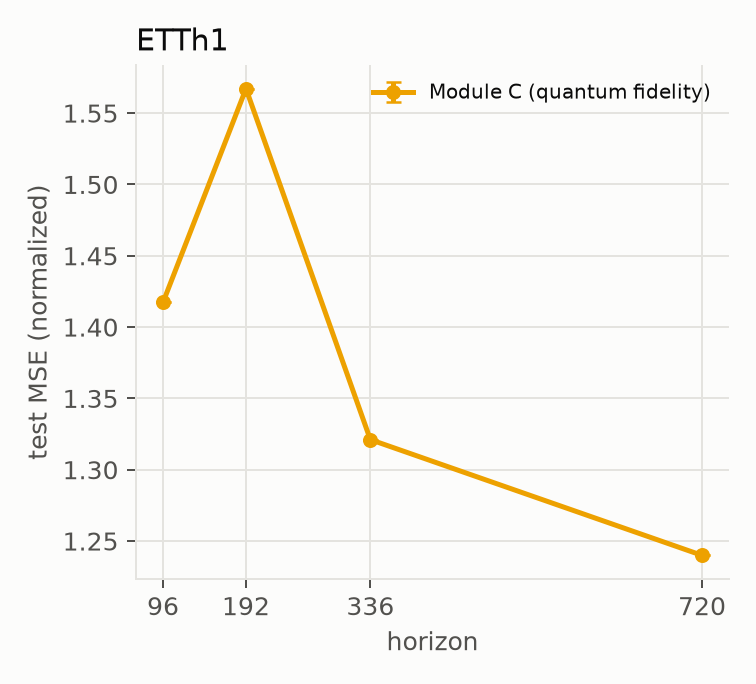

# Benchmark — Module C vs Transformer / iTransformer / PatchTST

Generated by `benchmarks/tsl/make_report.py`. Time-Series-Library protocol (`docs/benchmark_protocol.md`): multivariate `M`, input 96, horizons 96/192/336/720, TSL splits and train-only scaling. Module C reads the same windows from TSL's own data loaders (`qss.data.tsl_adapter`). Baseline hyper-parameters are TSL's official `scripts/long_term_forecast` settings. MSE / MAE on normalized values over all variables. Each cell: mean ± std over the finished seeds (of 2021–2025), `n` = number of seeds. Lower is better; the best mean per row is bold.

## ETTh1

| horizon | metric | Transformer | iTransformer | PatchTST | Module C (quantum fidelity) | Module C (cosine) | Module C (learned metric) |
|---|---|---|---|---|---|---|---|
| 96 | MSE | not run | not run | not run | **1.417 (n=1)** | 1.432 (n=1) | 1.453 (n=1) |
| 96 | MAE | not run | not run | not run | **0.942 (n=1)** | 0.947 (n=1) | 0.953 (n=1) |
| 192 | MSE | not run | not run | not run | **1.567 (n=1)** | 1.628 (n=1) | 1.604 (n=1) |
| 192 | MAE | not run | not run | not run | **0.973 (n=1)** | 0.994 (n=1) | 0.985 (n=1) |
| 336 | MSE | not run | not run | not run | 1.321 (n=1) | 1.299 (n=1) | **1.289 (n=1)** |
| 336 | MAE | not run | not run | not run | 0.897 (n=1) | 0.892 (n=1) | **0.889 (n=1)** |
| 720 | MSE | not run | not run | not run | 1.240 (n=1) | **1.227 (n=1)** | 1.233 (n=1) |
| 720 | MAE | not run | not run | not run | 0.898 (n=1) | **0.896 (n=1)** | 0.897 (n=1) |

## ETTm1

not run

## weather

not run

## traffic

not run

## Module C: quantum fidelity vs classical re-ranking

Paired by seed: Δ = MSE(quantum) − MSE(cosine). Negative means the quantum re-ranker helps.

| dataset | horizon | n | Δ MSE mean | Δ MSE std | quantum better in |
|---|---|---|---|---|---|
| ETTh1 | 96 | 1 | -0.0143 | 0.0000 | 1/1 seeds |
| ETTh1 | 192 | 1 | -0.0608 | 0.0000 | 1/1 seeds |
| ETTh1 | 336 | 1 | +0.0222 | 0.0000 | 0/1 seeds |
| ETTh1 | 720 | 1 | +0.0129 | 0.0000 | 0/1 seeds |

