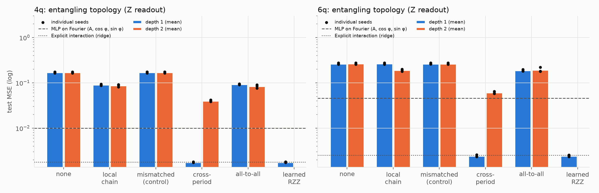
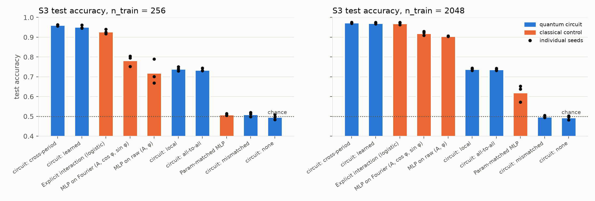

# Module A results — Structured Quantum Periodic Interaction

Generated by `experiments/synthetic_periodic/make_plots.py` from the JSON run records in `outputs/module_a/` (simulator: PennyLane `default.qubit`, exact expectations unless noted).

## S1 — amplitude–phase interaction (encoding comparison)

Target `y = A1·A2·cos(φ1 − φ2) + η`. Test MSE, mean ± std over 3 seeds; target-noise floor = 0.0004. Features are extracted by DFT from noisy series, so the floor is not reachable exactly.

| model | qubits | 2q gates | meas. settings | n=64 | n=256 | n=1024 | n=4096 |
|---|---|---|---|---|---|---|---|
| Fixed hybrid circuit + ridge | 2 | 0 | 9 | 0.0008 ± 0.0000 | 0.0006 ± 0.0000 | 0.0006 ± 0.0000 | 0.0006 ± 0.0000 |
| Explicit interaction (ridge) | – | – | – | 0.0007 ± 0.0000 | 0.0006 ± 0.0000 | 0.0006 ± 0.0000 | 0.0006 ± 0.0000 |
| Quantum hybrid / none / D=1 / pauli2 | 2 | 0 | 9 | 0.0007 ± 0.0000 | 0.0006 ± 0.0000 | 0.0006 ± 0.0000 | 0.0006 ± 0.0000 |
| Quantum phase circuit + classical A·A products / all_to_all / D=2 / z | 2 | 2 | 1 | 0.0007 ± 0.0001 | 0.0006 ± 0.0000 | 0.0006 ± 0.0000 | 0.0006 ± 0.0000 |
| Quantum hybrid / all_to_all / D=1 / z | 2 | 1 | 1 | 0.0006 ± 0.0000 | 0.0006 ± 0.0000 | 0.0006 ± 0.0000 | 0.0006 ± 0.0000 |
| MLP on raw (A, φ) | – | – | – | 0.0161 ± 0.0027 | 0.0049 ± 0.0007 | 0.0010 ± 0.0001 | 0.0006 ± 0.0000 |
| MLP on Fourier (A, cos φ, sin φ) | – | – | – | 0.0153 ± 0.0012 | 0.0038 ± 0.0004 | 0.0017 ± 0.0001 | 0.0007 ± 0.0000 |
| MLP + gated quantum fusion | 2 | 2 | 1 | 0.0135 ± 0.0036 | 0.0028 ± 0.0001 | 0.0012 ± 0.0001 | 0.0008 ± 0.0001 |
| Quantum angle / all_to_all / D=2 / z | 4 | 12 | 1 | 0.0027 ± 0.0005 | 0.0011 ± 0.0002 | 0.0006 ± 0.0000 | 0.0008 ± 0.0003 |
| Quantum angle / all_to_all / D=1 / z | 4 | 6 | 1 | 0.0040 ± 0.0004 | 0.0034 ± 0.0005 | 0.0030 ± 0.0002 | 0.0028 ± 0.0002 |
| Quantum hybrid / all_to_all / D=2 / z | 2 | 2 | 1 | 0.0331 ± 0.0028 | 0.0242 ± 0.0011 | 0.0225 ± 0.0002 | 0.0201 ± 0.0011 |
| Quantum hybrid / none / D=2 / pauli2 | 2 | 0 | 9 | 0.0431 ± 0.0051 | 0.0318 ± 0.0019 | 0.0292 ± 0.0017 | 0.0295 ± 0.0005 |
| Quantum phase circuit + classical A·A products / none / D=2 / pauli2 | 2 | 0 | 9 | 0.0513 ± 0.0025 | 0.0458 ± 0.0022 | 0.0472 ± 0.0027 | 0.0465 ± 0.0019 |
| Quantum angle / none / D=2 / pauli2 | 4 | 0 | 21 | 0.0723 ± 0.0064 | 0.0608 ± 0.0025 | 0.0562 ± 0.0013 | 0.0561 ± 0.0019 |
| Param-matched MLP | – | – | – | 0.0649 ± 0.0038 | 0.0589 ± 0.0014 | 0.0581 ± 0.0016 | 0.0597 ± 0.0036 |

**Finite-shot evaluation** (trained at n=4096, 500 test samples; MSE mean over seeds)

| model | exact | 100 shots | 1000 shots | 10000 shots |
|---|---|---|---|---|
| Quantum angle / all_to_all / D=1 / z | 0.0028 | 0.0131 | 0.0040 | 0.0029 |
| Quantum angle / all_to_all / D=2 / z | 0.0008 | 0.0298 | 0.0039 | 0.0011 |
| Quantum angle / none / D=2 / pauli2 | 0.0561 | 0.0587 | 0.0532 | 0.0527 |
| Quantum hybrid / all_to_all / D=1 / z | 0.0006 | 0.0098 | 0.0015 | 0.0006 |
| Quantum hybrid / all_to_all / D=2 / z | 0.0201 | 0.0276 | 0.0215 | 0.0210 |
| Quantum hybrid / none / D=1 / pauli2 | 0.0006 | 0.0279 | 0.0032 | 0.0008 |
| Quantum hybrid / none / D=2 / pauli2 | 0.0295 | 0.0486 | 0.0302 | 0.0287 |
| Quantum phase circuit + classical A·A products / all_to_all / D=2 / z | 0.0006 | 0.0041 | 0.0009 | 0.0006 |
| Quantum phase circuit + classical A·A products / none / D=2 / pauli2 | 0.0465 | 0.0455 | 0.0427 | 0.0425 |

## S2 — cross-period interaction (topology comparison)

One qubit per period patch, hybrid encoding, readout restricted to single-qubit ⟨Z⟩, so cross-patch terms must come from CZ entanglers. Parameter count is identical across topologies (fixed CZ). Test MSE, mean ± std over 3 seeds.

### 4q

| model | depth | 2q gates | circuit depth | meas. settings | train MSE | test MSE |
|---|---|---|---|---|---|---|
| Quantum hybrid / cross_period / D=1 / z | 1 | 2 | 5 | 1 | 0.0018 | 0.0018 ± 0.0000 |
| Quantum hybrid / learned RZZ / D=1 / z / L1=0.0 | 1 | 6 | 9 | 1 | 0.0018 | 0.0018 ± 0.0000 |
| Explicit interaction (ridge) | – | – | – | – | 0.0017 | 0.0018 ± 0.0000 |
| Quantum hybrid / none / D=1 / pauli2 | 1 | 0 | 4 | 21 | 0.0017 | 0.0018 ± 0.0001 |
| MLP on raw (A, φ) | – | – | – | – | 0.0022 | 0.0043 ± 0.0003 |
| MLP on Fourier (A, cos φ, sin φ) | – | – | – | – | 0.0045 | 0.0100 ± 0.0004 |
| Quantum hybrid / learned RZZ / D=1 / z / L1=0.003 | 1 | 6 | 9 | 1 | 0.0286 | 0.0312 ± 0.0209 |
| Quantum hybrid / cross_period / D=2 / z | 2 | 4 | 9 | 1 | 0.0370 | 0.0402 ± 0.0014 |
| Quantum hybrid / all_to_all / D=2 / z | 2 | 12 | 16 | 1 | 0.0775 | 0.0838 ± 0.0059 |
| Quantum hybrid / local / D=2 / z | 2 | 6 | 12 | 1 | 0.0777 | 0.0869 ± 0.0045 |
| Quantum hybrid / local / D=1 / z | 1 | 3 | 7 | 1 | 0.0836 | 0.0906 ± 0.0025 |
| Quantum hybrid / all_to_all / D=1 / z | 1 | 6 | 9 | 1 | 0.0930 | 0.0927 ± 0.0019 |
| Param-matched MLP | – | – | – | – | 0.1405 | 0.1449 ± 0.0039 |
| Quantum hybrid / none / D=2 / z | 2 | 0 | 7 | 1 | 0.1697 | 0.1700 ± 0.0047 |
| Quantum hybrid / none / D=1 / z | 1 | 0 | 4 | 1 | 0.1701 | 0.1704 ± 0.0050 |
| Quantum hybrid / mismatched / D=2 / z | 2 | 4 | 9 | 1 | 0.1694 | 0.1704 ± 0.0049 |
| Quantum hybrid / mismatched / D=1 / z | 1 | 2 | 5 | 1 | 0.1706 | 0.1707 ± 0.0048 |

### 6q

| model | depth | 2q gates | circuit depth | meas. settings | train MSE | test MSE |
|---|---|---|---|---|---|---|
| Quantum hybrid / learned RZZ / D=1 / z / L1=0.0 | 1 | 15 | 13 | 1 | 0.0024 | 0.0024 ± 0.0001 |
| Quantum hybrid / cross_period / D=1 / z | 1 | 3 | 5 | 1 | 0.0025 | 0.0024 ± 0.0001 |
| Explicit interaction (ridge) | – | – | – | – | 0.0023 | 0.0025 ± 0.0001 |
| Quantum hybrid / none / D=1 / pauli2 | 1 | 0 | 4 | 33 | 0.0024 | 0.0027 ± 0.0001 |
| MLP on raw (A, φ) | – | – | – | – | 0.0110 | 0.0285 ± 0.0035 |
| Quantum hybrid / learned RZZ / D=1 / z / L1=0.003 | 1 | 15 | 13 | 1 | 0.0307 | 0.0305 ± 0.0397 |
| MLP on Fourier (A, cos φ, sin φ) | – | – | – | – | 0.0100 | 0.0457 ± 0.0053 |
| Quantum hybrid / cross_period / D=2 / z | 2 | 6 | 9 | 1 | 0.0549 | 0.0606 ± 0.0029 |
| Quantum hybrid / all_to_all / D=1 / z | 1 | 15 | 13 | 1 | 0.1831 | 0.1876 ± 0.0067 |
| Quantum hybrid / local / D=2 / z | 2 | 10 | 14 | 1 | 0.1704 | 0.1897 ± 0.0091 |
| Quantum hybrid / all_to_all / D=2 / z | 2 | 30 | 22 | 1 | 0.1768 | 0.1940 ± 0.0187 |
| Param-matched MLP | – | – | – | – | 0.2312 | 0.2396 ± 0.0082 |
| Quantum hybrid / none / D=1 / z | 1 | 0 | 4 | 1 | 0.2592 | 0.2635 ± 0.0080 |
| Quantum hybrid / mismatched / D=2 / z | 2 | 6 | 9 | 1 | 0.2584 | 0.2639 ± 0.0085 |
| Quantum hybrid / mismatched / D=1 / z | 1 | 3 | 5 | 1 | 0.2607 | 0.2644 ± 0.0076 |
| Quantum hybrid / none / D=2 / z | 2 | 0 | 7 | 1 | 0.2591 | 0.2646 ± 0.0091 |
| Quantum hybrid / local / D=1 / z | 1 | 5 | 9 | 1 | 0.2611 | 0.2651 ± 0.0079 |

Quantum models: best of 5 random restarts per seed (selected on validation MSE).

## Learned topology — does the circuit find the cross-period edges itself?

Every qubit pair gets a trainable RZZ(γ); entangling strength = |sin γ| (0 = off, 1 = CZ-like). Initial strengths are small (|γ| ≤ 0.3). *Target share* = fraction of total strength on the pairs that enter the target.

| setting | seed | test MSE | target share | strengths (pair: value) |
|---|---|---|---|---|
| 4q, L1=0.003 | 42 | 0.0476 | 0.97 | 01:0.01, 02:1.00, 03:0.02, 12:0.01, 13:1.00, 23:0.01 |
| 4q, L1=0.003 | 43 | 0.0018 | 1.00 | 01:0.00, 02:1.00, 03:0.00, 12:0.00, 13:1.00, 23:0.00 |
| 4q, L1=0.003 | 44 | 0.0442 | 0.99 | 01:0.01, 02:1.00, 03:0.00, 12:0.00, 13:1.00, 23:0.01 |
| 4q, L1=0.0 | 42 | 0.0018 | 0.98 | 01:0.01, 02:1.00, 03:0.01, 12:0.01, 13:1.00, 23:0.01 |
| 4q, L1=0.0 | 43 | 0.0017 | 0.99 | 01:0.01, 02:1.00, 03:0.01, 12:0.01, 13:1.00, 23:0.01 |
| 4q, L1=0.0 | 44 | 0.0018 | 0.95 | 01:0.04, 02:1.00, 03:0.01, 12:0.01, 13:1.00, 23:0.04 |
| 6q, L1=0.003 | 42 | 0.0026 | 1.00 | 01:0.00, 02:0.00, 03:1.00, 04:0.00, 05:0.00, 12:0.00, 13:0.00, 14:1.00, 15:0.00, 23:0.00, 24:0.00, 25:1.00, 34:0.00, 35:0.00, 45:0.00 |
| 6q, L1=0.003 | 43 | 0.0866 | 0.92 | 01:0.00, 02:0.01, 03:1.00, 04:0.03, 05:0.00, 12:0.00, 13:0.03, 14:0.00, 15:0.01, 23:0.01, 24:0.02, 25:1.00, 34:0.00, 35:0.02, 45:0.04 |
| 6q, L1=0.003 | 44 | 0.0023 | 1.00 | 01:0.00, 02:0.00, 03:1.00, 04:0.00, 05:0.00, 12:0.00, 13:0.00, 14:1.00, 15:0.00, 23:0.00, 24:0.00, 25:1.00, 34:0.00, 35:0.00, 45:0.00 |
| 6q, L1=0.0 | 42 | 0.0026 | 0.96 | 01:0.01, 02:0.01, 03:1.00, 04:0.01, 05:0.02, 12:0.01, 13:0.01, 14:1.00, 15:0.01, 23:0.02, 24:0.01, 25:1.00, 34:0.01, 35:0.01, 45:0.00 |
| 6q, L1=0.0 | 43 | 0.0024 | 0.94 | 01:0.03, 02:0.00, 03:1.00, 04:0.02, 05:0.00, 12:0.03, 13:0.02, 14:1.00, 15:0.01, 23:0.00, 24:0.01, 25:1.00, 34:0.02, 35:0.00, 45:0.03 |
| 6q, L1=0.0 | 44 | 0.0024 | 0.95 | 01:0.02, 02:0.01, 03:1.00, 04:0.02, 05:0.02, 12:0.00, 13:0.02, 14:1.00, 15:0.01, 23:0.01, 24:0.00, 25:1.00, 34:0.02, 35:0.02, 45:0.00 |

## S3 — structured classification (periodic pattern labels)

Same series as S2 with 4 period patches; label = 1 if the noisy S2 score Σ A_k·A_{k+2}·cos(φ_k − φ_{k+2}) is positive (patches one super-period apart are on balance in phase). Balanced classes, chance = 0.5. BCE-with-logits training, threshold 0; quantum models use ⟨Z⟩ readout only, best of 3 restarts on validation BCE. Test accuracy and macro-F1, mean ± std over 3 seeds.

| model | 2q gates | acc n=256 | macro-F1 n=256 | acc n=2048 | macro-F1 n=2048 |
|---|---|---|---|---|---|
| Quantum hybrid / cross_period / D=1 / z | 2 | 0.9610 ± 0.0032 | 0.9610 ± 0.0032 | 0.9735 ± 0.0025 | 0.9735 ± 0.0025 |
| Quantum hybrid / learned RZZ / D=1 / z / L1=0.0 | 6 | 0.9518 ± 0.0069 | 0.9518 ± 0.0069 | 0.9710 ± 0.0033 | 0.9710 ± 0.0033 |
| Explicit interaction (logistic) | – | 0.9273 ± 0.0091 | 0.9273 ± 0.0091 | 0.9698 ± 0.0052 | 0.9698 ± 0.0052 |
| MLP on Fourier (A, cos φ, sin φ) | – | 0.7835 ± 0.0226 | 0.7833 ± 0.0228 | 0.9202 ± 0.0083 | 0.9201 ± 0.0083 |
| MLP on raw (A, φ) | – | 0.7198 ± 0.0513 | 0.7192 ± 0.0516 | 0.9055 ± 0.0012 | 0.9054 ± 0.0012 |
| Quantum hybrid / local / D=1 / z | 3 | 0.7397 ± 0.0084 | 0.7385 ± 0.0094 | 0.7385 ± 0.0048 | 0.7383 ± 0.0049 |
| Quantum hybrid / all_to_all / D=1 / z | 6 | 0.7352 ± 0.0059 | 0.7346 ± 0.0055 | 0.7367 ± 0.0043 | 0.7366 ± 0.0043 |
| Param-matched MLP | – | 0.5088 ± 0.0038 | 0.4653 ± 0.0553 | 0.6207 ± 0.0353 | 0.6132 ± 0.0451 |
| Quantum hybrid / mismatched / D=1 / z | 2 | 0.5095 ± 0.0088 | 0.4860 ± 0.0217 | 0.4983 ± 0.0048 | 0.4450 ± 0.0536 |
| Quantum hybrid / none / D=1 / z | 0 | 0.4963 ± 0.0102 | 0.4377 ± 0.0715 | 0.4933 ± 0.0083 | 0.3918 ± 0.0644 |

Learned RZZ topology: the target edges (0,2) and (1,3) carry 91–98% of the total entangling strength in all 6 runs, as in S2.

