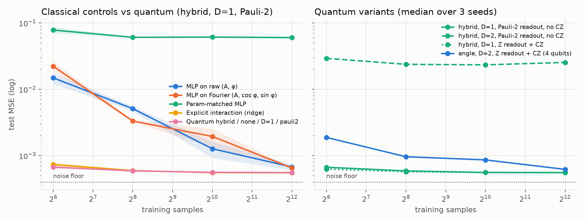
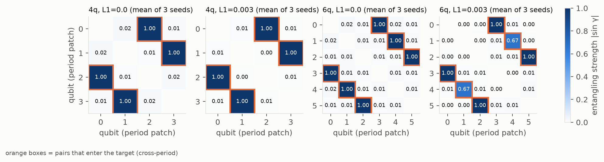

# Module A results — Structured Quantum Periodic Interaction

Generated by `experiments/synthetic_periodic/make_plots.py` from the JSON run records in `outputs/module_a/` (simulator: PennyLane `default.qubit`, exact expectations unless noted).

## S1 — amplitude–phase interaction (encoding comparison)

Target `y = A1·A2·cos(φ1 − φ2) + η`. Test MSE, mean ± std over 3 seeds; target-noise floor = 0.0004. Features are extracted by DFT from noisy series, so the floor is not reachable exactly.

| model | qubits | 2q gates | meas. settings | n=64 | n=256 | n=1024 | n=4096 |
|---|---|---|---|---|---|---|---|
| Fixed hybrid circuit + ridge | 2 | 0 | 9 | 0.0008 ± 0.0000 | 0.0006 ± 0.0000 | 0.0006 ± 0.0000 | 0.0006 ± 0.0000 |
| Explicit interaction (ridge) | – | – | – | 0.0007 ± 0.0001 | 0.0006 ± 0.0000 | 0.0006 ± 0.0000 | 0.0006 ± 0.0000 |
| Quantum hybrid / none / D=1 / pauli2 | 2 | 0 | 9 | 0.0007 ± 0.0000 | 0.0006 ± 0.0000 | 0.0006 ± 0.0000 | 0.0006 ± 0.0000 |
| Quantum phase circuit + classical A·A products / all_to_all / D=2 / z | 2 | 2 | 1 | 0.0007 ± 0.0000 | 0.0006 ± 0.0000 | 0.0006 ± 0.0000 | 0.0006 ± 0.0000 |
| Quantum hybrid / all_to_all / D=1 / z | 2 | 1 | 1 | 0.0006 ± 0.0000 | 0.0006 ± 0.0000 | 0.0006 ± 0.0000 | 0.0006 ± 0.0000 |
| Quantum angle / all_to_all / D=2 / z | 4 | 12 | 1 | 0.0019 ± 0.0001 | 0.0010 ± 0.0000 | 0.0009 ± 0.0001 | 0.0006 ± 0.0001 |
| MLP on Fourier (A, cos φ, sin φ) | – | – | – | 0.0223 ± 0.0037 | 0.0033 ± 0.0001 | 0.0019 ± 0.0006 | 0.0007 ± 0.0000 |
| MLP on raw (A, φ) | – | – | – | 0.0149 ± 0.0028 | 0.0051 ± 0.0005 | 0.0013 ± 0.0003 | 0.0007 ± 0.0001 |
| MLP + gated quantum fusion | 2 | 2 | 1 | 0.0147 ± 0.0005 | 0.0030 ± 0.0006 | 0.0011 ± 0.0002 | 0.0007 ± 0.0000 |
| Quantum angle / all_to_all / D=1 / z | 4 | 6 | 1 | 0.0018 ± 0.0002 | 0.0016 ± 0.0001 | 0.0016 ± 0.0001 | 0.0016 ± 0.0001 |
| Quantum hybrid / all_to_all / D=2 / z | 2 | 2 | 1 | 0.0226 ± 0.0013 | 0.0194 ± 0.0005 | 0.0182 ± 0.0005 | 0.0173 ± 0.0007 |
| Quantum hybrid / none / D=2 / pauli2 | 2 | 0 | 9 | 0.0303 ± 0.0024 | 0.0235 ± 0.0008 | 0.0239 ± 0.0013 | 0.0250 ± 0.0009 |
| Quantum phase circuit + classical A·A products / none / D=2 / pauli2 | 2 | 0 | 9 | 0.0509 ± 0.0009 | 0.0484 ± 0.0037 | 0.0474 ± 0.0018 | 0.0443 ± 0.0022 |
| Quantum angle / none / D=2 / pauli2 | 4 | 0 | 21 | 0.0701 ± 0.0083 | 0.0586 ± 0.0031 | 0.0571 ± 0.0007 | 0.0557 ± 0.0018 |
| Param-matched MLP | – | – | – | 0.0785 ± 0.0088 | 0.0609 ± 0.0007 | 0.0614 ± 0.0019 | 0.0604 ± 0.0021 |

**Finite-shot evaluation** (trained at n=4096, 500 test samples; MSE mean over seeds)

| model | exact | 100 shots | 1000 shots | 10000 shots |
|---|---|---|---|---|
| Quantum angle / all_to_all / D=1 / z | 0.0016 | 0.0159 | 0.0029 | 0.0018 |
| Quantum angle / all_to_all / D=2 / z | 0.0006 | 0.0417 | 0.0046 | 0.0011 |
| Quantum angle / none / D=2 / pauli2 | 0.0557 | 0.0551 | 0.0521 | 0.0522 |
| Quantum hybrid / all_to_all / D=1 / z | 0.0006 | 0.0119 | 0.0016 | 0.0007 |
| Quantum hybrid / all_to_all / D=2 / z | 0.0173 | 0.0233 | 0.0173 | 0.0166 |
| Quantum hybrid / none / D=1 / pauli2 | 0.0006 | 0.0385 | 0.0045 | 0.0009 |
| Quantum hybrid / none / D=2 / pauli2 | 0.0250 | 0.0480 | 0.0257 | 0.0237 |
| Quantum phase circuit + classical A·A products / all_to_all / D=2 / z | 0.0006 | 0.0030 | 0.0008 | 0.0006 |
| Quantum phase circuit + classical A·A products / none / D=2 / pauli2 | 0.0443 | 0.0426 | 0.0410 | 0.0406 |

## S2 — cross-period interaction (topology comparison)

One qubit per period patch, hybrid encoding, readout restricted to single-qubit ⟨Z⟩, so cross-patch terms must come from CZ entanglers. Parameter count is identical across topologies (fixed CZ). Test MSE, mean ± std over 3 seeds.

### 4q

| model | depth | 2q gates | circuit depth | meas. settings | train MSE | test MSE |
|---|---|---|---|---|---|---|
| Quantum hybrid / cross_period / D=1 / z | 1 | 2 | 5 | 1 | 0.0018 | 0.0018 ± 0.0000 |
| Quantum hybrid / learned RZZ / D=1 / z / L1=0.0 | 1 | 6 | 9 | 1 | 0.0018 | 0.0018 ± 0.0000 |
| Explicit interaction (ridge) | – | – | – | – | 0.0017 | 0.0018 ± 0.0000 |
| Quantum hybrid / none / D=1 / pauli2 | 1 | 0 | 4 | 21 | 0.0017 | 0.0018 ± 0.0001 |
| MLP on raw (A, φ) | – | – | – | – | 0.0025 | 0.0041 ± 0.0000 |
| MLP on Fourier (A, cos φ, sin φ) | – | – | – | – | 0.0041 | 0.0091 ± 0.0006 |
| Quantum hybrid / learned RZZ / D=1 / z / L1=0.003 | 1 | 6 | 9 | 1 | 0.0153 | 0.0170 ± 0.0216 |
| Quantum hybrid / cross_period / D=2 / z | 2 | 4 | 9 | 1 | 0.0369 | 0.0399 ± 0.0016 |
| Quantum hybrid / local / D=2 / z | 2 | 6 | 12 | 1 | 0.0782 | 0.0858 ± 0.0036 |
| Quantum hybrid / all_to_all / D=2 / z | 2 | 12 | 16 | 1 | 0.0819 | 0.0878 ± 0.0059 |
| Quantum hybrid / local / D=1 / z | 1 | 3 | 7 | 1 | 0.0832 | 0.0899 ± 0.0030 |
| Quantum hybrid / all_to_all / D=1 / z | 1 | 6 | 9 | 1 | 0.0883 | 0.0919 ± 0.0020 |
| Param-matched MLP | – | – | – | – | 0.1415 | 0.1447 ± 0.0032 |
| Quantum hybrid / mismatched / D=2 / z | 2 | 4 | 9 | 1 | 0.1708 | 0.1697 ± 0.0042 |
| Quantum hybrid / none / D=2 / z | 2 | 0 | 7 | 1 | 0.1700 | 0.1706 ± 0.0050 |
| Quantum hybrid / none / D=1 / z | 1 | 0 | 4 | 1 | 0.1702 | 0.1709 ± 0.0050 |
| Quantum hybrid / mismatched / D=1 / z | 1 | 2 | 5 | 1 | 0.1707 | 0.1710 ± 0.0053 |

### 6q

| model | depth | 2q gates | circuit depth | meas. settings | train MSE | test MSE |
|---|---|---|---|---|---|---|
| Quantum hybrid / cross_period / D=1 / z | 1 | 3 | 5 | 1 | 0.0025 | 0.0024 ± 0.0001 |
| Explicit interaction (ridge) | – | – | – | – | 0.0023 | 0.0025 ± 0.0001 |
| Quantum hybrid / none / D=1 / pauli2 | 1 | 0 | 4 | 33 | 0.0023 | 0.0026 ± 0.0001 |
| Quantum hybrid / learned RZZ / D=1 / z / L1=0.0 | 1 | 15 | 13 | 1 | 0.0162 | 0.0175 ± 0.0211 |
| MLP on raw (A, φ) | – | – | – | – | 0.0108 | 0.0256 ± 0.0056 |
| MLP on Fourier (A, cos φ, sin φ) | – | – | – | – | 0.0081 | 0.0429 ± 0.0051 |
| Quantum hybrid / cross_period / D=2 / z | 2 | 6 | 9 | 1 | 0.0573 | 0.0639 ± 0.0015 |
| Quantum hybrid / learned RZZ / D=1 / z / L1=0.003 | 1 | 15 | 13 | 1 | 0.1162 | 0.1206 ± 0.0448 |
| Quantum hybrid / all_to_all / D=2 / z | 2 | 30 | 22 | 1 | 0.1718 | 0.1960 ± 0.0087 |
| Quantum hybrid / local / D=2 / z | 2 | 10 | 14 | 1 | 0.1807 | 0.1988 ± 0.0167 |
| Quantum hybrid / all_to_all / D=1 / z | 1 | 15 | 13 | 1 | 0.1933 | 0.2001 ± 0.0187 |
| Param-matched MLP | – | – | – | – | 0.2312 | 0.2377 ± 0.0082 |
| Quantum hybrid / local / D=1 / z | 1 | 5 | 9 | 1 | 0.2578 | 0.2642 ± 0.0079 |
| Quantum hybrid / mismatched / D=1 / z | 1 | 3 | 5 | 1 | 0.2600 | 0.2643 ± 0.0080 |
| Quantum hybrid / none / D=1 / z | 1 | 0 | 4 | 1 | 0.2595 | 0.2647 ± 0.0077 |
| Quantum hybrid / none / D=2 / z | 2 | 0 | 7 | 1 | 0.2589 | 0.2652 ± 0.0083 |
| Quantum hybrid / mismatched / D=2 / z | 2 | 6 | 9 | 1 | 0.2610 | 0.2666 ± 0.0069 |

Quantum models: best of 5 random restarts per seed (selected on validation MSE).

## Learned topology — does the circuit find the cross-period edges itself?

Every qubit pair gets a trainable RZZ(γ); entangling strength = |sin γ| (0 = off, 1 = CZ-like). Initial strengths are small (|γ| ≤ 0.3). *Target share* = fraction of total strength on the pairs that enter the target.

| setting | seed | test MSE | target share | strengths (pair: value) |
|---|---|---|---|---|
| 4q, L1=0.003 | 42 | 0.0475 | 0.98 | 01:0.01, 02:1.00, 03:0.02, 12:0.01, 13:1.00, 23:0.01 |
| 4q, L1=0.003 | 43 | 0.0017 | 1.00 | 01:0.00, 02:1.00, 03:0.00, 12:0.00, 13:1.00, 23:0.00 |
| 4q, L1=0.003 | 44 | 0.0018 | 1.00 | 01:0.00, 02:1.00, 03:0.00, 12:0.00, 13:1.00, 23:0.00 |
| 4q, L1=0.0 | 42 | 0.0018 | 0.99 | 01:0.00, 02:1.00, 03:0.01, 12:0.01, 13:1.00, 23:0.00 |
| 4q, L1=0.0 | 43 | 0.0017 | 0.96 | 01:0.02, 02:1.00, 03:0.03, 12:0.03, 13:1.00, 23:0.02 |
| 4q, L1=0.0 | 44 | 0.0017 | 0.98 | 01:0.01, 02:1.00, 03:0.01, 12:0.01, 13:1.00, 23:0.01 |
| 6q, L1=0.003 | 42 | 0.1838 | 0.77 | 01:0.01, 02:0.01, 03:0.01, 04:0.03, 05:0.01, 12:0.04, 13:0.00, 14:1.00, 15:0.07, 23:0.00, 24:0.00, 25:0.01, 34:0.03, 35:0.00, 45:0.09 |
| 6q, L1=0.003 | 43 | 0.0869 | 0.90 | 01:0.01, 02:0.00, 03:1.00, 04:0.02, 05:0.01, 12:0.01, 13:0.07, 14:0.00, 15:0.00, 23:0.02, 24:0.03, 25:1.00, 34:0.01, 35:0.02, 45:0.03 |
| 6q, L1=0.003 | 44 | 0.0909 | 0.93 | 01:0.02, 02:0.00, 03:1.00, 04:0.01, 05:0.01, 12:0.03, 13:0.04, 14:1.00, 15:0.00, 23:0.00, 24:0.00, 25:0.01, 34:0.00, 35:0.00, 45:0.03 |
| 6q, L1=0.0 | 42 | 0.0026 | 0.92 | 01:0.02, 02:0.05, 03:1.00, 04:0.01, 05:0.04, 12:0.01, 13:0.01, 14:1.00, 15:0.01, 23:0.03, 24:0.01, 25:1.00, 34:0.01, 35:0.05, 45:0.01 |
| 6q, L1=0.0 | 43 | 0.0024 | 0.93 | 01:0.00, 02:0.05, 03:1.00, 04:0.02, 05:0.01, 12:0.02, 13:0.02, 14:1.00, 15:0.00, 23:0.01, 24:0.00, 25:1.00, 34:0.00, 35:0.05, 45:0.02 |
| 6q, L1=0.0 | 44 | 0.0473 | 0.87 | 01:0.00, 02:0.11, 03:1.00, 04:0.00, 05:0.01, 12:0.03, 13:0.06, 14:1.00, 15:0.01, 23:0.01, 24:0.01, 25:1.00, 34:0.04, 35:0.12, 45:0.04 |

